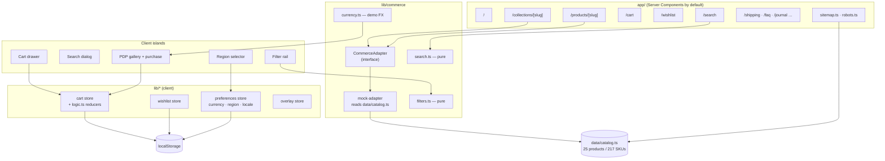

# AUREL STUDIO — Portfolio Case Study

> **Portfolio demo.** A front-end storefront built to show how a cross-border DTC site is
> engineered. It has no payment, no orders, no accounts and no backend. Where the copy
> touches shipping, returns or duties, those pages say so explicitly.

| | |
|---|---|
| Brand | AUREL STUDIO — Contemporary Essentials |
| Type | Headless-commerce storefront front end (portfolio) |
| Market | US / UK / EU, English-first with a German interface |
| Audience | Modern essentials shoppers, 25–40 |
| Stack | Next.js 16.4.2 (App Router, Turbopack, Cache Components) · React 19.3 · TypeScript 5 (strict) · Tailwind CSS 4 |
| State | Zustand 5 — cart, wishlist, overlays, display preferences |
| Testing | Vitest (116 unit) · Playwright (34 E2E) |
| Catalogue | 25 products · 217 SKUs · 7 categories |

## What this project demonstrates

1. **A real variant model, not mock cards.** Colour × size produces SKUs with their own
   inventory, SKU string, price and image set. Sold-out sizes are disabled at the data layer,
   not hidden in the UI.
2. **A commerce seam.** Every page reads through `CommerceAdapter`; swapping the mock for
   Shopify Storefront API is one file plus one export.
3. **Cart state that cannot lie.** Lines are built only from variants, quantities clamp to
   live stock, and totals are recomputed from the catalogue on every read.
4. **Cross-border presentation with the honesty boundary intact.** USD is the only
   settlement currency; EUR/GBP are reference conversions with a visible notice, and the
   JSON-LD never publishes a converted price.
5. **Technical SEO that a crawler can actually read** — canonical per page, filtered views
   noindex, product JSON-LD with an offer per SKU, sitemap of 33 canonical URLs, and no
   `hreflang` for a language that has no URLs.
6. **Evidence over claims.** 116 unit tests, 34 E2E tests, Lighthouse runs before and after,
   and a QA pass that fixed 6 of 8 audit findings and documented the other 2.

## Architecture

Rendering strategy: static where possible, **PPR** (`cacheComponents`) for the routes that
read `searchParams`; the product and collection routes are prerendered per slug with the
dynamic segment streamed.

## Features

### Home
Full-bleed campaign hero, asymmetric category pair, four-product new-arrivals row, dark
editorial band, newsletter. Server-rendered; the only client work is the language switch and
the header actions.

### Collection (`/collections/[slug]`)
Seven collections. Colour / size / price filters, four sort orders, active-filter chips,
mobile filter drawer, empty state, loading skeleton. **The URL is the state** — every control
rewrites the query string and the server re-renders, so a filtered view is shareable and
survives reload. Size filters mean "this size is buyable", not "this product has that size".

### Product detail (`/products/[slug]`)
Gallery with thumbnails and zoom, colour swatches that swap the photography, size chips driven
by per-SKU stock, sold-out sizes disabled, add-to-bag gated on a valid size, size guide,
material/care/shipping, related products.

### Cart
Right-hand drawer and a full `/cart` page on one store: variant-level lines, quantity stepper
clamped to stock, remove, live subtotal, free-shipping progress, empty state. Persisted to
localStorage and **reconciled** on load: vanished SKUs are dropped, sold-out lines removed,
quantities clamped, prices refreshed from the catalogue.

### Wishlist
Heart on every card, header count, `/wishlist` page. Stored as **slugs**, so prices and stock
always come from the catalogue and cannot go stale.

### Search
Header dialog with live results (deferred rendering, no debounce timer), five previews plus
"view all", Enter for the full page, and `/search?q=` that reuses the collection filter and
sort components. Weighted token matching over title, subtitle, category, collections, colour
names, tags, material and description — 13 unit tests.

### Multi-currency, region and language
USD / EUR / GBP with a fixed demonstration rate table, a region selector that suggests a
currency, and an English/German interface (typed dictionaries; a missing German key fails the
build). Prices reformat to German conventions (`446,20 €`). Switching either never touches
the bag, wishlist or SKU data.

### Technical SEO
Per-page canonical, Open Graph with the product's own image, product JSON-LD (one `Offer` per
real SKU, `priceCurrency: "USD"` always), `BreadcrumbList`, `sitemap.xml` (33 URLs, no query
strings), `robots.txt` driven by `SEO_INDEXING`, `noindex` on cart/wishlist/search, and
filtered collection views canonicalised back to the clean URL.

## Screenshots

`docs/portfolio/screenshots/`

| File | View |
|---|---|
| `01-home-desktop.png` | Home, 1440 × 900 |
| `02-home-mobile.png` | Home, 390 × 844 |
| `03-collection-desktop.png` | Collection with filter rail |
| `04-product-desktop.png` | PDP, gallery + purchase panel |
| `05-cart-desktop.png` | Cart page with a line and summary |
| `06-wishlist-desktop.png` | Wishlist |
| `07-search-results.png` | `/search?q=wool` |
| `08-currency-gbp.png` | GBP display after choosing United Kingdom |
| `09-language-de.png` | German interface, EUR, cart |
| `10-product-mobile.png` | PDP, 390 × 844 |

Captured by `node scripts/screenshots.mjs` against the production build. No mocked state, no
edited screenshots; the German/EUR screenshot is a real region + language switch.

## Verified, not claimed

| Check | Command | Result |
|---|---|---|
| Types | `npm run typecheck` | pass |
| Lint | `npm run lint` | pass (`--max-warnings=0`) |
| Unit | `npm test` | 116 passed |
| E2E | `npx playwright test` | 34 passed (desktop 30 + mobile 4) |
| Build | `npm run build` | 43 routes |
| Lighthouse (mobile emulation, local) | see `PERFORMANCE_REPORT.md` | Perf 93–97 / 94 / 93, A11y 100, CLS 0 |

## Deliberate boundaries

- **No checkout.** The button is disabled and explains why.
- **No multi-currency settlement.** Reference prices only; JSON-LD stays USD.
- **No German URLs.** German is an interface preview; no `hreflang` is emitted.
- **No invented commerce data.** No ratings, reviews, GTINs, shipping terms, sales figures.
- **Five products lack category-correct photography** — documented in
  `PRODUCT_IMAGE_AUDIT.md` rather than papered over.
